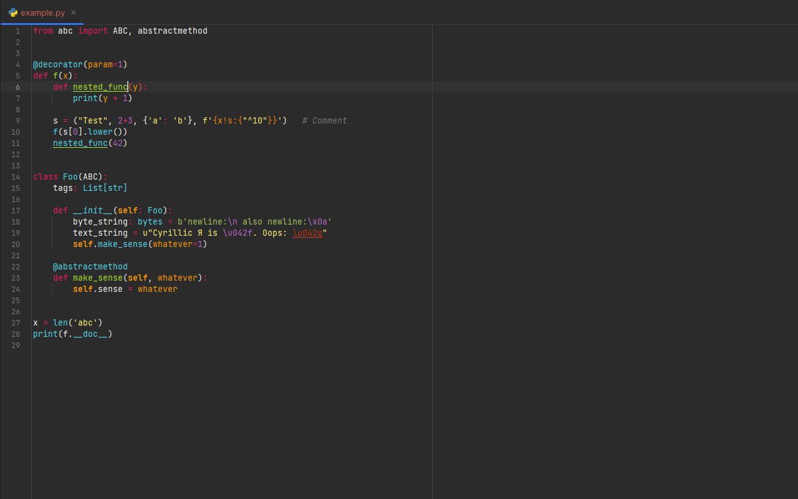
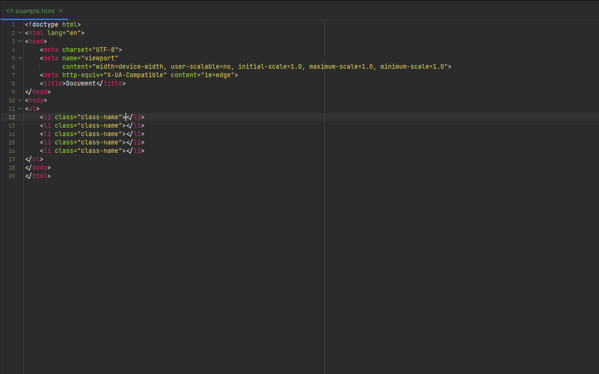
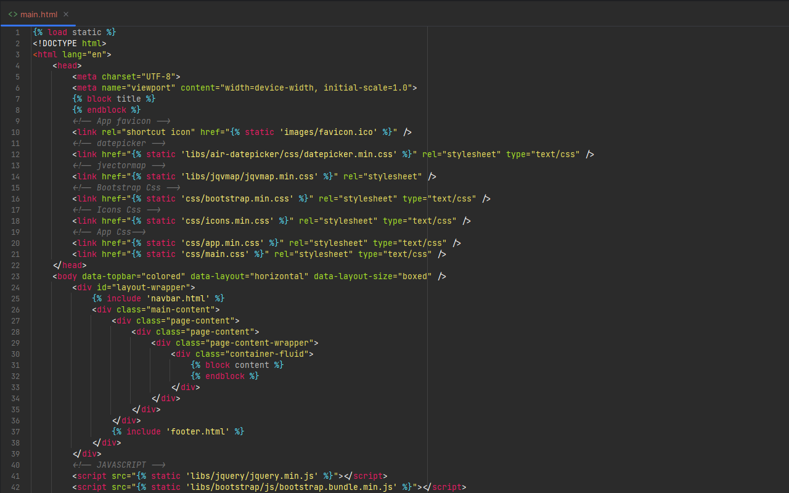
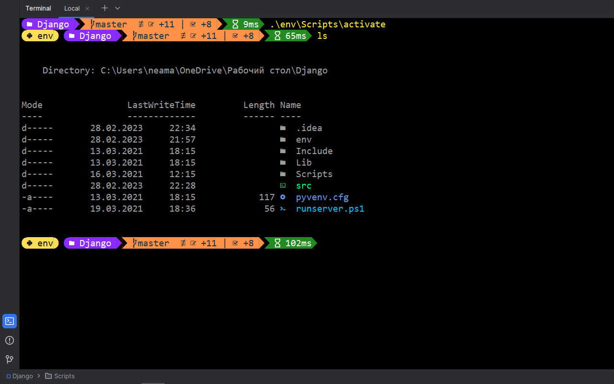

# Monokai by Neo

The Monokai theme as in [Sublime Text](https://www.sublimetext.com/), which I tried to repeat as closely as possible (at least for Python). Not a perfect copy, but better than the rest of the themes for you if you decide to switch to Pycharm after Sublime like me.

## Examples

### Python



### HTML



### Template for Django



## Installing

### As plugin

1. Download `Monokai_by_Neo.jar` from the [latest release](https://github.com/neamaddin/monokai-by-neo/releases/latest).
2. Open Settings/Preferences -> Plugins -> gear icon -> Install Plugin from Disk.
3. Select the downloaded JAR and restart the IDE if requested.
4. Select **Monokai by Neo** in Editor -> Color Scheme.

You can also search for **Monokai by Neo** in Marketplace. Marketplace updates are published separately from GitHub releases.

### As color scheme

1. Download `Monokai_by_Neo.icls` from the [latest release](https://github.com/neamaddin/monokai-by-neo/releases/latest).
2. Open Settings/Preferences -> Editor -> Color Scheme -> gear icon -> Import Scheme.
3. Select the downloaded `.icls` file.

## Building

Requires Python 3, with no external dependencies:

```sh
python3 scripts/build.py
```

The script validates the plugin descriptor and color scheme, then rebuilds
`Monokai_by_Neo.jar` from the tracked XML files. The archive uses fixed timestamps
for reproducible builds. For a release, update the version and change notes in
`META-INF/plugin.xml`, rebuild, and attach the JAR and the scheme (with an `.icls`
extension) to the GitHub release. Upload the JAR to JetBrains Marketplace separately.

## Changes in 1.2

- Fixed `InvalidDataException: Dark` on IDE startup and plugin reload by inheriting
  from the bundled `Darcula` scheme.
- Added a reproducible build with XML and archive validation.

## Font

The recommended font for this color scheme is [Hasklig](https://github.com/wclr/my-nerd-fonts/tree/master/Consolas%20NF).
[Consolas NF](https://github.com/wclr/my-nerd-fonts/tree/master/Consolas%20NF) is set as the font for the console, it is necessary for the correct display of Unicode characters, because I use [Oh My Posh](https://ohmyposh.dev/)



## License

This project is licensed under the MIT License. See the [LICENSE](LICENSE) file for details.
